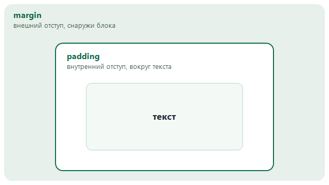

# Занятие 1. Первая веб-страница

Фронтенд — это та часть сайта, которую человек видит в браузере. Сегодня делаем именно её.

## 1. Из чего состоит страница

Браузер получает обычные текстовые файлы и по ним рисует страницу.

- **HTML** описывает содержимое и порядок блоков: заголовок, абзац, список, ссылка.
- **CSS** описывает вид: цвет, шрифт, отступы, ширину.

Один и тот же HTML можно перекрасить, не переписывая текст. Для этого меняют CSS.

Страница собирается из **тегов**. Тег обычно состоит из открывающей и закрывающей части:

```html
<h1>Это заголовок</h1>
<p>Это абзац.</p>
```

Текст между тегами — содержимое. Имя тега говорит браузеру, что это за блок.

У тега бывают **атрибуты**: дополнительные настройки. Их пишут в открывающем теге.

```html
<a href="https://ru.wikipedia.org">Открыть Википедию</a>
```

Здесь `href` — адрес, по которому ведёт ссылка. На странице виден текст «Открыть Википедию».

Теги можно вкладывать друг в друга, как коробки. Внутренний тег закрывают раньше внешнего:

```html
<ul>
  <li>Первый пункт</li>
  <li>Второй пункт</li>
</ul>
```

`ul` — весь список, `li` — один пункт. Пункт живёт внутри списка.

Так устроена сегодняшняя страница:

```text
html
├── head
│   ├── meta     кодировка, чтобы русские буквы отображались верно
│   ├── title    название вкладки браузера
│   └── link     подключение файла CSS
└── body
    └── карточка
        ├── header   шапка: главный заголовок
        ├── main     основной текст, список и ссылка
        └── footer   короткая подпись внизу
```

`<title>` виден на вкладке браузера. `<h1>` виден на самой странице. Это разные места.

## 2. Создай файлы в WebStorm

Всё создаём в уже открытом проекте, через левую панель **Project**. Если панели не видно, нажми `Alt+1`.

В конце в проекте должна появиться такая папка:

```text
my-page/
  index.html
  style.css
```

1. Правой кнопкой по названию проекта в панели **Project** → **New** → **Directory**.
2. Введи имя `my-page` и нажми Enter.
3. Правой кнопкой по папке `my-page` → **New** → **HTML File**.
4. В поле имени напиши `index` и нажми Enter. WebStorm сам добавит расширение `.html` и вставит заготовку страницы.
5. Правой кнопкой по папке `my-page` → **New** → **File**.
6. Введи имя `style.css` и нажми Enter. Этот файл пока пустой.

Имена пиши строчными латинскими буквами.

Чтобы открыть страницу в браузере, открой `index.html` и нажми значок браузера в правом верхнем углу редактора. Тот же пункт есть в контекстном меню файла: **Open in** → **Browser**.

Перед просмотром сохраняй файл (`Ctrl+S`). В браузере обновляй страницу клавишей `F5`.

## 3. Набери каркас

WebStorm уже вставил в `index.html` похожую заготовку. Выдели всё содержимое файла (`Ctrl+A`) и замени его на этот каркас.

```html
<!DOCTYPE html>
<html lang="ru">
<head>
  <meta charset="UTF-8">
  <title>Мой первый сайт</title>
</head>
<body>

</body>
</html>
```

Что означает каждая строка:

- `<!DOCTYPE html>` — страница написана на современном HTML.
- `<html lang="ru">` — документ на русском языке.
- `<head>` — служебная часть. Её содержимое обычно не видно как текст страницы.
- `<meta charset="UTF-8">` — кодировка. Без неё русские буквы часто превращаются в кракозябры.
- `<title>` — название вкладки.
- `<body>` — всё, что человек видит на странице.

**Проверь.** Сохрани файл, открой его в браузере. На вкладке написано «Мой первый сайт», сама страница пустая, странных символов нет.

Теги `meta` и позже `link` не имеют закрывающей пары. Так и задумано.

## 4. Добавь содержимое

Замени пустой `<body>` на этот блок. Верх страницы до `<body>` не удаляй.

```html
<body>
  <div class="card">
    <header>
      <h1>Настольные игры вечером</h1>
      <p>Короткий вечер с друзьями иногда лучше длинной ленты в телефоне.</p>
    </header>

    <main>
      <h2>Три игры, с которых легко начать</h2>
      <ul>
        <li><strong>Уно</strong> — правила за пять минут</li>
        <li><strong>Имаджинариум</strong> — нужно придумывать ассоциации</li>
        <li><strong>Кодовые имена</strong> — игра на слова и намёки</li>
      </ul>

      <h2>Куда заглянуть</h2>
      <p>
        Описания есть в статье
        <a href="https://ru.wikipedia.org/wiki/Настольная_игра">«Настольная игра»</a>.
      </p>
    </main>

    <footer>
      <p>Сделано на первом занятии по веб-разработке.</p>
    </footer>
  </div>
</body>
```

Новые теги:

| Тег | Зачем |
| --- | --- |
| `h1` | Главный заголовок страницы. На странице он один |
| `h2` | Заголовок раздела, меньше главного |
| `p` | Абзац |
| `ul` / `li` | Маркированный список и его пункт |
| `strong` | Важное слово внутри текста. Браузер показывает его жирным |
| `a` | Ссылка. Адрес лежит в `href` |
| `header` | Шапка блока |
| `main` | Основное содержимое |
| `footer` | Нижняя подпись |
| `div` | Просто коробка для группировки. Класс `card` пригодится для CSS |

`class="card"` — имя коробки. По этому имени CSS найдёт её и оформит. Имя класса придумываем сами, латиницей, без пробелов.

**Проверь.** На странице видны заголовок, абзац, три пункта и ссылка. Ссылка открывает статью. Выглядит пока как обычный документ: белый фон, чёрный текст, синяя ссылка. Так и должно быть, CSS ещё не подключён.

Это учебный текст. В задании ниже ты заменишь его на свой.

## 5. Подключи оформление

В `<head>`, сразу после `<title>`, добавь строку:

```html
<link rel="stylesheet" href="style.css">
```

`href` здесь — путь к файлу CSS. Файл лежит рядом с `index.html`, поэтому достаточно имени `style.css`.

В `style.css` вставь:

```css
body {
  margin: 0;
  font-family: Arial, sans-serif;
  background-color: #e7f0ea;
  color: #1f2933;
}

.card {
  max-width: 640px;
  margin: 40px auto;
  padding: 28px;
  background-color: #ffffff;
  border-radius: 16px;
}

h1 {
  margin-top: 0;
  color: #0f6b4c;
}

h2 {
  color: #155e75;
}

a {
  color: #0f6b4c;
}

footer {
  margin-top: 24px;
  color: #52606d;
}
```

Правило CSS читается так: **кого оформляем**, затем в фигурных скобках пары **свойство: значение**.

```css
h1 {
  color: #0f6b4c;
}
```

- `h1` — селектор. Это все заголовки первого уровня.
- `.card` — селектор класса. Точка обязательна. В HTML точка не пишется: там `class="card"`.
- `color` — цвет текста.
- `#0f6b4c` — код цвета. Можно писать и имена: `teal`, `tomato`, `steelblue`.
- Точка с запятой закрывает объявление.

Свойства из файла:

| Свойство | Что делает |
| --- | --- |
| `margin` | Внешний отступ вокруг блока |
| `padding` | Внутренний отступ между краем блока и текстом |
| `font-family` | Шрифт. `Arial, sans-serif` значит: взять Arial, а если его нет — похожий шрифт без засечек |
| `background-color` | Цвет фона |
| `color` | Цвет текста |
| `max-width` | Максимальная ширина. На широком мониторе строка не растягивается слишком сильно |
| `border-radius` | Скругление углов |

`margin: 40px auto` у `.card`: сверху и снизу 40 пикселей, слева и справа `auto`. Из-за `auto` карточка встаёт по центру.

Внешний и внутренний отступ — разные вещи:



**Проверь.** Фон страницы зелёноватый, белая карточка по центру, заголовок зелёный. Если вид не изменился, проверь по порядку: файл сохранён, в `<head>` есть `link`, у `href` имя `style.css`, перед `card` в CSS стоит точка, страница обновлена через `F5`.

Короткий опыт, чтобы увидеть связь файлов: поменяй `background-color` у `body` на `lightblue`, сохрани и обнови браузер. Потом верни свой цвет. HTML при этом не меняется.

## 6. Задание: сделай свою страницу

Замени учебный пример на страницу про то, что интересно тебе. Подойдёт любимая игра, хобби, вид спорта, животное, сериал или город, в который хочется поехать.

На странице должно быть:

- `<meta charset="UTF-8">` и свой `<title>`;
- подключённый `style.css`;
- один `h1`;
- хотя бы один абзац из двух-трёх своих предложений;
- список минимум из трёх пунктов;
- одна рабочая ссылка на статью, официальный сайт или ролик;
- класс у карточки и оформление в CSS.

В CSS измени вид под свою тему. Обязательно задай сам:

- фон страницы;
- цвет главного заголовка;
- внутренний отступ карточки;
- ширину карточки или скругление углов.

Тема, фразы и цвета должны отличаться от учебного примера про настольные игры.

Пиши только то, чем можно поделиться в классе: имя можно, фамилию, телефон, адрес, школу, класс и логины — нет.

**Проверь перед сдачей:**

- [ ] В папке лежат `index.html` и `style.css`
- [ ] Страница открывается в браузере
- [ ] На вкладке свой заголовок
- [ ] Русский текст читается нормально
- [ ] Есть `h1`, абзац, список и ссылка
- [ ] Ссылка открывает нужный адрес
- [ ] Цвета и карточка приходят из CSS
- [ ] Текст и цвета свои

Как убедиться, что CSS действительно подключён: временно переименуй `style.css`, обнови страницу — оформление пропадёт. Верни файлу прежнее имя и обнови ещё раз.

Покажи преподавателю открытую страницу и оба файла.

## 7. Если что-то сломалось

| Что видно | Что проверить |
| --- | --- |
| На странице видны теги `html`, `body`, `h1` | Файл сохранён как `.txt` или открыт не браузером, а редактором |
| Вместо букв ромбики и вопросики | В `head` есть `<meta charset="UTF-8">`, файл сохранён |
| Вкладка называется «Мой первый сайт», а заголовок на странице другой | Так и бывает: `title` и `h1` задаются отдельно. Поменяй оба |
| CSS не применяется | Имя файла, строка `link`, точка у класса, точка с запятой, `Ctrl+S`, `F5` |
| Ссылка не нажимается | У `a` есть `href`, адрес в кавычках, тег закрыт |
| Несколько строк из файла слиплись в одну | Перенос строки в HTML не начинает новый абзац. Оберни каждую мысль в `<p>` или `<li>` |
| Следующий блок оказался внутри предыдущего | Каждый открытый тег нужно закрыть. Сначала закрывается внутренний тег, потом внешний |
| Цвет записан, но правило не работает | Селектор написан с ошибкой: `.card` в CSS и `class="card"` в HTML должны совпадать |
| Кавычки выглядят как «» или “” | Нужны прямые кавычки `"` |

Кавычки и скобки из примера лучше набирать самому, а не копировать из мессенджера: оттуда часто приезжают «красивые» кавычки, которые браузер не понимает.

## Шпаргалка

Каркас, который нужен почти каждой странице:

```html
<!DOCTYPE html>
<html lang="ru">
<head>
  <meta charset="UTF-8">
  <title>Название вкладки</title>
  <link rel="stylesheet" href="style.css">
</head>
<body>
</body>
</html>
```

Теги этого занятия: `h1`, `h2`, `p`, `ul`, `li`, `a`, `strong`, `header`, `main`, `footer`, `div`, `img`.

Свойства этого занятия: `color`, `background-color`, `font-family`, `margin`, `padding`, `max-width`, `border-radius`.

У ссылки можно задать отдельный вид, когда на неё наведён курсор: селектор `a:hover`.

## Образец целиком

Это готовый учебный пример. Его можно сверить со своим файлом, если запутался в скобках. Сдавать его без своих текстов и цветов не нужно.

`index.html`

```html
<!DOCTYPE html>
<html lang="ru">
<head>
  <meta charset="UTF-8">
  <title>Настольные игры</title>
  <link rel="stylesheet" href="style.css">
</head>
<body>
  <div class="card">
    <header>
      <h1>Настольные игры вечером</h1>
      <p>Короткий вечер с друзьями иногда лучше длинной ленты в телефоне.</p>
    </header>

    <main>
      <h2>Три игры, с которых легко начать</h2>
      <ul>
        <li><strong>Уно</strong> — правила за пять минут</li>
        <li><strong>Имаджинариум</strong> — нужно придумывать ассоциации</li>
        <li><strong>Кодовые имена</strong> — игра на слова и намёки</li>
      </ul>

      <h2>Куда заглянуть</h2>
      <p>
        Описания есть в статье
        <a href="https://ru.wikipedia.org/wiki/Настольная_игра">«Настольная игра»</a>.
      </p>
    </main>

    <footer>
      <p>Сделано на первом занятии по веб-разработке.</p>
    </footer>
  </div>
</body>
</html>
```

`style.css`

```css
body {
  margin: 0;
  font-family: Arial, sans-serif;
  background-color: #e7f0ea;
  color: #1f2933;
}

.card {
  max-width: 640px;
  margin: 40px auto;
  padding: 28px;
  background-color: #ffffff;
  border-radius: 16px;
}

h1 {
  margin-top: 0;
  color: #0f6b4c;
}

h2 {
  color: #155e75;
}

a {
  color: #0f6b4c;
}

footer {
  margin-top: 24px;
  color: #52606d;
}
```

## Практическое задание. Страница с картинкой

Сверстай новую страницу: карточка с фотографией и ссылкой, которая меняет цвет, когда на неё наводят курсор.

В панели **Project** правой кнопкой по названию проекта:

1. **New** → **Directory**, имя `simple-page`.
2. Правой кнопкой по `simple-page` → **New** → **HTML File**, имя `index`.
3. Правой кнопкой по `simple-page` → **New** → **File**, имя `style.css`.
4. Картинку можно взять двумя способами. Файл со своего компьютера перетащи в папку `simple-page` и назови латиницей, например `photo.jpg`. Либо ничего не скачивай и укажи в `src` адрес картинки из интернета.

Заготовку `index.html` замени на каркас страницы и подключи `style.css`. В `body` собери такую карточку:

```html
<div class="card">
  
  <h1>Заголовок</h1>
  <p>Два-три предложения своими словами.</p>
  <a href="https://ru.wikipedia.org">Текст ссылки</a>
</div>
```

Заголовок, абзац, текст ссылки и адрес замени на свои.

`src` — откуда брать картинку. Это может быть файл рядом со страницей или любая картинка в интернете.

Файл в той же папке:

```html

```

Имя в `src` должно совпадать с файлом, включая `.jpg` или `.png`.

Адрес в интернете:

```html

```

Сюда вставляют полную ссылку на саму картинку. Она начинается с `https://`. Файл при этом не лежит в папке: браузер загружает его по адресу, поэтому страница должна быть открыта с интернетом. Ссылка на сайт целиком не подойдёт, нужен адрес именно картинки.

Если картинка не появилась, проверь имя файла и папку либо открой адрес из `src` в браузере: должна открыться сама картинка.

`alt` — запасной текст на случай, если картинка не появилась. Так бывает, когда нет интернета, сломалась ссылка или файл не найден: вместо фото человек видит эту подпись. Её же зачитывают программы, которыми пользуются люди, не видящие экран.

В `alt` описывают, что на фото. Для снимка кота на подоконнике подойдёт `alt="Рыжий кот на подоконнике"`. Имя файла вроде `photo.jpg` и слово «картинка» человеку ничего не объясняют.

Карточку оформи как в занятии: фон на всё окно, карточка по центру и уже окна, белый фон, внутренний отступ, скругление углов, свой цвет у заголовка.

Саму картинку впиши в карточку:

```css
img {
  display: block;
  width: 100%;
  margin-bottom: 16px;
  border-radius: 12px;
}
```

`width: 100%` растягивает фото на ширину карточки, шире карточки оно не станет. `display: block` убирает лишнюю белую полоску под картинкой. `border-radius` скругляет углы фото.

Цвет ссылки и цвет при наведении задай отдельно:

```css
a {
  color: teal;
}

a:hover {
  color: tomato;
}
```

`:hover` — вид элемента в тот момент, когда курсор находится на нём. Цвета поставь свои. Наведи курсор на ссылку: текст должен перекраситься. Если ничего не меняется, сохрани `style.css` и обнови страницу.

Тему возьми по картинке: питомец, место, хобби, игра или блюдо. Фразы напиши сам. На фото не ставь документы, адреса и чужие лица крупным планом.

Открой `index.html` значком браузера в правом верхнем углу редактора.

**Проверь:**

- [ ] В папке `simple-page` лежат `index.html` и `style.css`, а картинка либо лежит рядом, либо указана ссылкой в `src`
- [ ] На вкладке свой заголовок, русский текст читается
- [ ] Карточка по центру, фон занимает окно
- [ ] Картинка видна, на ширину карточки, углы у неё скруглены
- [ ] Под картинкой свой заголовок, абзац и ссылка
- [ ] При наведении на ссылку её цвет меняется
- [ ] Ссылка открывает нужный адрес

Покажи преподавателю открытую страницу.
