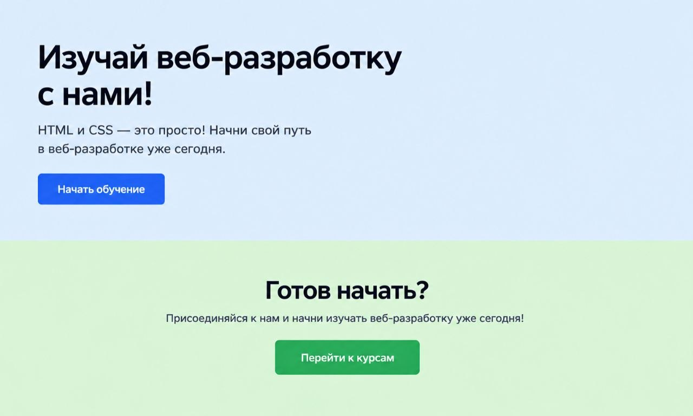
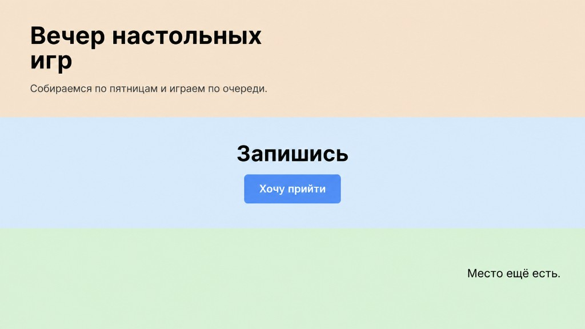
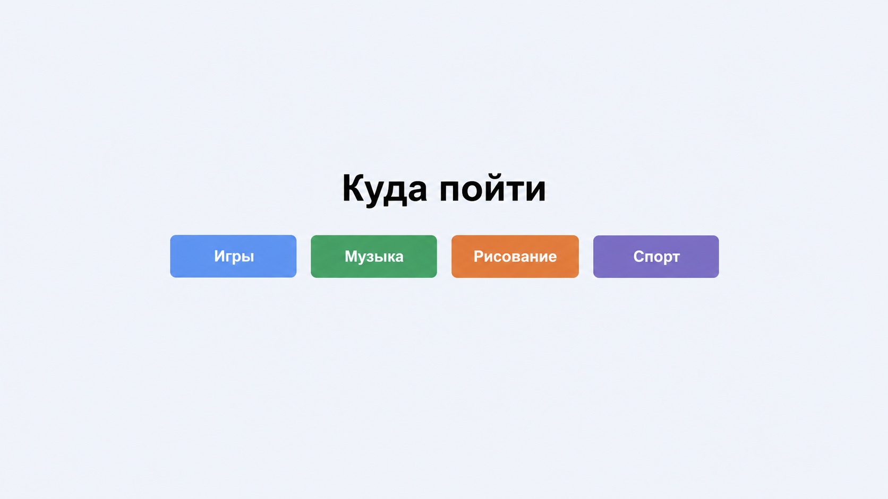
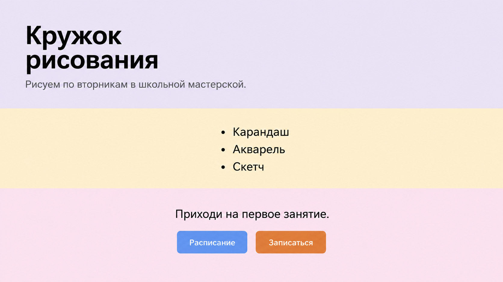

# Занятие 2. Кнопки и блоки

Сегодня страница состоит из широких цветных полос, а ссылка выглядит как кнопка. Ниже только новые приёмы. Как собрать из них страницу, реши сам.

## Что пригодится

`<section>` — крупный блок страницы. У него, как у любого блока, задаются фон и внутренний отступ.

У `body` с самого начала есть внешний отступ. Из-за него по краям окна остаётся белая полоса. Его убирают свойством `margin`.

`text-align` выравнивает содержимое блока. `left` прижимает к левому краю, `center` ставит по центру, `right` прижимает к правому.

` ` переносит остаток текста на следующую строку внутри того же заголовка или абзаца.

`font-size` задаёт размер текста, например `font-size: 32px`.

Ссылку можно превратить в кнопку:

- `display: inline-block` делает её прямоугольником, и внутренний отступ `padding` работает как поля внутри кнопки;
- `text-decoration: none` убирает подчёркивание;
- `background-color` красит прямоугольник, `color` красит текст;
- `border-radius` скругляет углы.

На тёмной или яркой кнопке текст делают светлым, иначе его не прочитать.

`:hover` уже знаком. Им можно менять фон кнопки, когда курсор на ней.

`filter: brightness(0.88)` меняет яркость уже покрашенного элемента: число меньше 1 затемняет, больше 1 осветляет.

В атрибуте `class` можно написать несколько имён через пробел. Каждое имя оформляется своим правилом в CSS.

## 1. Задание. Кнопка

Сделай маленькую страницу, на которой ссылка выглядит как кнопка.

В панели **Project** (`Alt+1`) правой кнопкой по проекту:

1. **New** → **Directory**, имя `button`.
2. Правой кнопкой по `button` → **New** → **HTML File**, имя `index`.
3. Правой кнопкой по `button` → **New** → **File**, имя `style.css`.

Каркас страницы тот же, что на первом занятии: `lang="ru"`, кодировка, свой `title`, подключённый `style.css`.

На странице должны быть заголовок, одно предложение и ссылка. Ссылка открывает любую подходящую статью.

Как это выглядит:

- текст и кнопка по центру окна;
- кнопка — цветной прямоугольник со светлым текстом и скруглёнными углами;
- подчёркивания нет;
- при наведении фон кнопки темнее.

**Проверь.** Кнопка читается, кликается и заметно меняется под курсором.

## 2. Задание. Страница по картинке

Сверстай страницу так, чтобы она совпала с картинкой. Держи картинку рядом с браузером.

Тексты бери с картинки. Папку `landing` создай так же, как `button`: внутри `index.html` и `style.css`.

На картинке два широких блока друг под другом. Оба тянутся на всю ширину окна.

1. Верхний блок голубой. Текст слева. Заголовок крупный, в две строки. Абзац тоже в две строки. Синяя кнопка «Начать обучение».
2. Нижний блок зелёный. Заголовок, абзац и зелёная кнопка «Перейти к курсам» стоят по центру.

Кнопки устроены так же, как в первом задании, только цвет у каждой свой. При наведении кнопка темнеет и остаётся своего цвета: синяя синей, зелёная зелёной. У каждой кнопки есть адрес.

Цвета, отступы и размер заголовка подбери по картинке.

**Проверь:**

- [ ] Оба блока на всю ширину окна, белой полосы по краям нет
- [ ] Верхний блок голубой, текст слева, заголовок крупный и в две строки
- [ ] Нижний блок зелёный, его содержимое по центру
- [ ] Обе кнопки без подчёркивания, со светлым текстом и со скруглением
- [ ] При наведении каждая темнеет и не меняет свой цвет на чужой
- [ ] Обе кнопки куда-то ведут
- [ ] Страница рядом с картинкой выглядит так же

## 3. Задание. Три полосы

Сверстай страницу по картинке. Держи её рядом с браузером.

Папку `bands` создай так же, как `button`. Внутри `index.html` и `style.css`. Тексты бери с картинки.

Три блока на всю ширину окна, один под другим. У каждого свой фон. Белой рамки по краям окна нет.

1. Верхний блок: текст слева, заголовок в две строки и абзац.
2. Средний блок: заголовок и одна кнопка по центру.
3. Нижний блок: предложение с картинки и под ним кнопка. Оба стоят справа. Подпись кнопки придумай сам, например «Написать».

Кнопки как в первом задании: прямоугольник, светлый текст, без подчёркивания, при наведении темнеют. Внизу на картинке кнопки нет, её добавляешь сам.

**Проверь:**

- [ ] Полосы на всю ширину и разного цвета
- [ ] В первой текст слева, во второй по центру
- [ ] В третьей справа предложение и под ним кнопка
- [ ] Обе кнопки кликаются
- [ ] Остальная страница рядом с картинкой выглядит так же

## 4. Задание. Четыре кнопки

Сверстай страницу по картинке. Держи её рядом с браузером.

Папка `actions`, в ней `index.html` и `style.css`. Тексты бери с картинки.

Один блок на всю ширину. Заголовок по центру. Под ним четыре кнопки в один ряд. У каждой свой цвет и свой адрес. Кнопки не растянуты на всю ширину.

При наведении кнопка темнеет и остаётся своего цвета. На картинке наведения нет, его добавляешь сам.

**Проверь:**

- [ ] На странице ровно четыре кнопки, все по центру
- [ ] Подписи и цвета как на картинке
- [ ] Каждая открывает свою страницу
- [ ] Под курсором ни одна не перекрашивается в цвет соседней

## 5. Задание. Своя страница

Сверстай страницу так же по блокам, как на картинке. Тексты, цвета и тему возьми свои: игра, кружок, город или хобби. С картинки ничего не копируй. Имя указать можно. Фамилию, телефон, адрес и школу не пиши.

Папка `my-blocks`, в ней `index.html` и `style.css`.

Три широких блока с разными фонами:

1. Слева крупный заголовок в две строки и абзац.
2. По центру список из трёх пунктов.
3. Предложение и две кнопки разного цвета. Кнопки ведут на разные адреса. При наведении каждая темнеет и сохраняет свой цвет.

**Проверь:**

- [ ] Три блока на всю ширину, белой рамки по краям нет
- [ ] В первом текст слева и заголовок в две строки
- [ ] Во втором список по центру
- [ ] В третьем две разные кнопки, обе кликаются
- [ ] Тексты про свою тему
