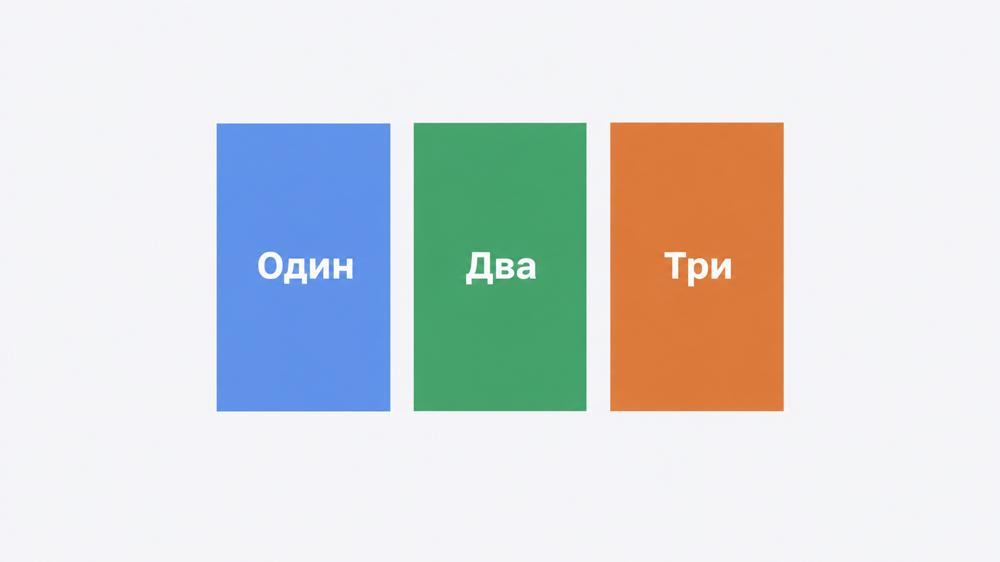
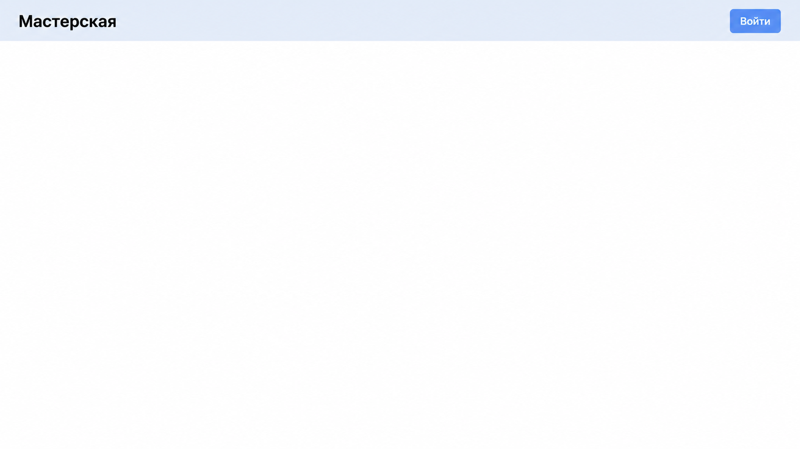
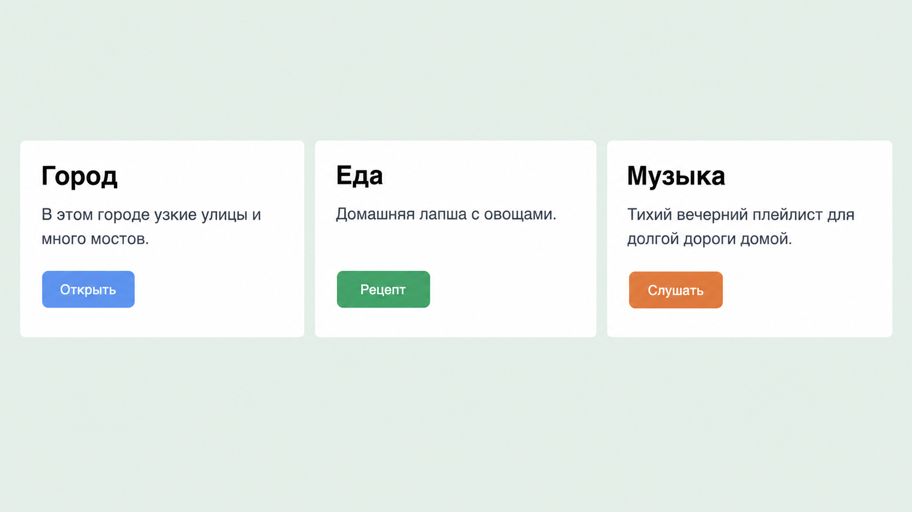
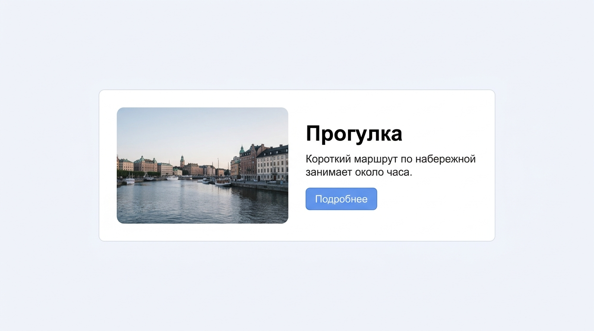
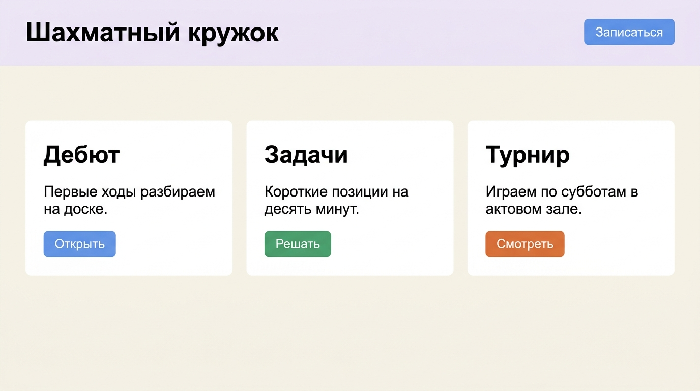
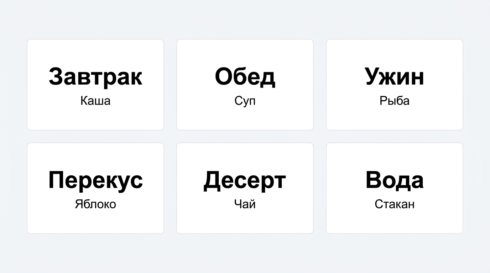
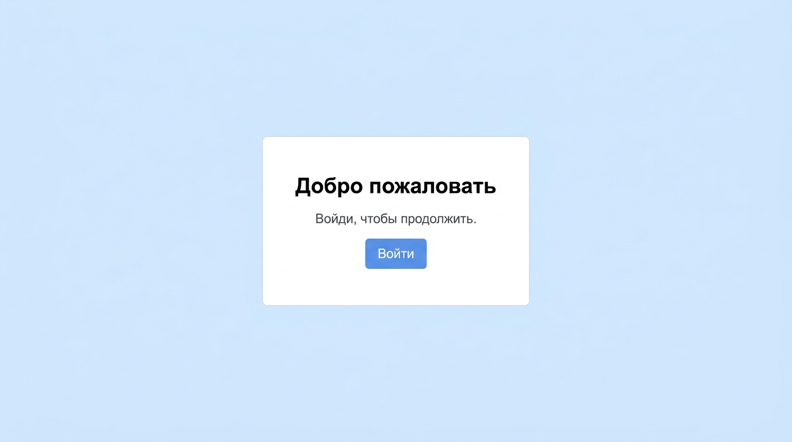

# Занятие 3. Блоки в ряд

До этого блоки стояли только друг под другом. Flex ставит их в ряд: несколько карточек рядом, заголовок слева и кнопка справа.

## 1. Теория

Открой любой сайт: магазин, расписание, страницу фильма. Одни и те же куски встречаются почти везде. Раньше ты умел ставить блоки только столбиком. Flex нужен, когда блоки должны встать **рядом** и держать между собой порядок, даже если текст в одном из них длиннее.

Так выглядит обычная страница, если смотреть только на ряды:

```text
шапка сайта
[ Название                        Войти ]

лента товаров или фильмов
[ карточка ] [ карточка ] [ карточка ]

страница одной вещи
[ фото слева | название, цена и кнопка справа ]

узкое окно
[ карточка ] [ карточка ]
[ карточка ] [ карточка ]
```

Без flex шапка разваливается: кнопка падает под название. Карточки товаров встают столбиком на всю ширину. Фото и описание оказываются друг под другом, хотя на макете они рядом. Flex как раз собирает эти места.

### Родитель включает ряд

`display: flex` пишут на обёртке, не на каждой карточке. Дети этой обёртки встают в ряд. `gap` задаёт один промежуток между ними, чтобы карточки не слипались. Снаружи ряда этот промежуток не появляется.

```css
.row {
  display: flex;
  gap: 16px;
}
```

Так делают ленту карточек, ряд кнопок, пункты меню. Пока у родителя нет `display: flex`, дети остаются столбиком, как на первых занятиях.

`flex-direction: row` — ряд слева направо. Это направление уже стоит по умолчанию. `flex-direction: column` снова собирает столбик, но уже с `gap` и выравниванием flex. Внутри карточки так ставят заголовок, текст и кнопку сверху вниз с ровным промежутком.

### Края и свободное место

`justify-content` распределяет детей вдоль ряда. На сайте это ответ на вопрос «где стоит кнопка, если справа осталось пустое место».

| Значение | Зачем так делают |
| --- | --- |
| `flex-start` | Прижать ряд к началу. Так по умолчанию, например пункты меню слева |
| `center` | Поставить ряд по центру. Так ставят несколько кнопок под заголовком |
| `flex-end` | Прижать ряд к концу. Так группу ссылок уводят вправо |
| `space-between` | Развести края. Слева название сайта, справа кнопка «Войти», пустота между ними |

`align-items` выравнивает детей поперёк ряда. В горизонтальном ряду это вертикаль. В шапке название и кнопка должны стоять на одной линии, даже если у кнопки больше высота. Для этого ставят `align-items: center`.

| Значение | Зачем так делают |
| --- | --- |
| `stretch` | Вытянуть детей на одну высоту. Карточки в ленте выглядят ровно, хотя текст в них разной длины. Так по умолчанию |
| `center` | Поставить по центру высоты. Шапка, ряд кнопок |
| `flex-start` | По верхнему краю. Если карточки не должны тянуться |
| `flex-end` | По нижнему краю |

### Одинаковые колонки

`flex: 1` пишут на ребёнке, не на родителе. Ребёнок забирает равную долю свободного места. Три карточки с `flex: 1` остаются одной ширины на широком и на узком окне. Так устроена сетка «три товара в ряд»: не считают пиксели руками.

На странице товара тот же приём: фото слева фиксированной ширины, а блок с названием и кнопкой с `flex: 1` забирает всё, что осталось.

Flex вкладывают. Снаружи ряд карточек. Внутри одной карточки другой flex: картинка и текст рядом. Родителю каждого ряда нужно своё `display: flex`.

### Когда ряд не влезает

На широком экране в ряд входят три карточки. На узком они не должны вылезать за край и ломать страницу. `flex-wrap: wrap` переносит лишние на следующую строку. Перенос начнётся, только если у ребёнка есть ширина, например `flex-basis: 200px`. Иначе он сожмётся и останется в первой строке.

Так лента товаров на телефоне сама становится двумя колонками, а не одной бесконечной строкой с прокруткой вбок.

### Блок по центру экрана

Страница входа и заставка часто состоят из одной карточки ровно посередине окна. Высоту родителя задают как `height: 100vh`: `vh` считается от высоты окна, `100vh` — всё окно. Потом у этого родителя включают flex и ставят `justify-content: center` вместе с `align-items: center`. Один центр двигает карточку по горизонтали, второй по вертикали. Пока высота родителя не на весь экран, вертикальный центр не виден: карточка просто стоит у верхнего края.

## 2. Задания

Папки создавай как на прошлом занятии: в панели **Project** правой кнопкой по проекту → **New** → **Directory**, внутри **HTML File** `index` и **File** `style.css`. Каркас страницы тот же: `lang="ru"`, кодировка, свой `title`, подключённый `style.css`. У `body` убери внешний отступ.

Кнопки делай как на втором занятии: прямоугольник, светлый текст, без подчёркивания, при наведении темнеет и не меняет свой цвет на чужой.

### 1. Три цветных блока

Сверстай страницу по картинке. Держи её рядом с браузером.



Папка `row`.

Три прямоугольника в один ряд, по центру окна, с промежутком между ними. Подписи: «Один», «Два», «Три». Фоны разные. Высота заметная, текст внутри по центру блока.

**Проверь:**

- [ ] Блоки стоят в ряд, не друг под другом
- [ ] Между ними есть промежуток
- [ ] Ряд по центру окна
- [ ] Текст внутри каждого блока по центру

### 2. Шапка

Сверстай страницу по картинке. Держи её рядом с браузером.



Папка `header`.

Полоса на всю ширину окна. Слева название «Мастерская», справа кнопка «Войти». Между ними пустое место. Название и кнопка на одной вертикали, по центру высоты полосы. У полосы свой фон и внутренний отступ.

**Проверь:**

- [ ] Название у левого края, кнопка у правого
- [ ] Они на одной линии по вертикали
- [ ] Кнопка кликается и темнеет при наведении

### 3. Три карточки

Сверстай страницу по картинке. Держи её рядом с браузером.



Папка `cards`. Тексты бери с картинки.

Три карточки в один ряд на всю ширину, одинаковой ширины, с одинаковым промежутком. У каждой белый фон, внутренний отступ и скругление. Фон страницы другого цвета.

В каждой карточке сверху вниз: заголовок, одно предложение, кнопка.

Тексты:

1. «Город». Предложение про город. Кнопка «Открыть».
2. «Еда». Предложение про еду. Кнопка «Рецепт».
3. «Музыка». Предложение про музыку. Кнопка «Слушать».

У кнопок три разных цвета. Если в одной карточке текст длиннее, карточки всё равно одной высоты.

**Проверь:**

- [ ] Три карточки в ряд и одной ширины
- [ ] Внутри текст идёт сверху вниз, не в ряд
- [ ] Кнопки разного цвета и все кликаются
- [ ] Высота карточек совпадает

### 4. Картинка и текст рядом

Сверстай карточку по картинке: фото слева, текст справа.



Папка `side`. Тексты бери с картинки.

Одна карточка по центру окна, уже экрана. Внутри два блока в ряд: слева фото, справа заголовок, абзац и кнопка. Само фото возьми адресом из интернета или файлом рядом со страницей, не вставляй этот макет целиком. В `alt` опиши, что на фото. Правая часть занимает оставшуюся ширину карточки. Кнопка не растянута на всю эту ширину.

**Проверь:**

- [ ] Картинка слева, текст справа
- [ ] Картинка не вылезает из карточки
- [ ] Кнопка по ширине текста, а не на всю правую часть
- [ ] `alt` описывает фото

### 5. Своя страница

Сверстай страницу так же по блокам, как на картинке. Тексты, цвета и тему возьми свои. С картинки ничего не копируй.



Папка `my-row`.

Тема своя: игра, кружок, город или хобби. Имя указать можно. Фамилию, телефон, адрес и школу не пиши.

На странице:

- шапка на всю ширину: название слева, кнопка справа;
- под ней ряд из трёх карточек одинаковой ширины;
- в карточке заголовок, предложение и кнопка;
- кнопки разного цвета, при наведении темнеют и остаются своего цвета.

**Проверь:**

- [ ] Шапка и ряд карточек собраны через flex
- [ ] Три карточки одной ширины
- [ ] Тексты про свою тему
- [ ] Все кнопки кликаются

## 3. Задания со звёздочкой

### 6. Перенос на новую строку ★

Сверстай страницу по картинке. Держи её рядом с браузером.



Папка `wrap`. Тексты бери с картинки.

Шесть карточек. В одном ряду их не больше трёх: остальные переходят на следующую строку. Промежуток есть и между колонками, и между строками. У карточки есть заголовок и одно слово. Ширина карточек одинаковая.

**Проверь:**

- [ ] Видны две строки карточек
- [ ] В первой строке три карточки
- [ ] Промежуток есть и по горизонтали, и по вертикали
- [ ] Если сильно сузить окно, карточки не вылезают за край

### 7. Ровно по центру экрана ★

Сверстай страницу по картинке. Держи её рядом с браузером.



Папка `center`. Тексты бери с картинки.

На пустом экране одна карточка. Она стоит ровно посередине: и по горизонтали, и по вертикали. Вокруг неё виден фон страницы. В карточке заголовок, одно предложение и кнопка.

Карточка остаётся в центре, если менять высоту окна.

**Проверь:**

- [ ] Карточка в центре экрана, не у верхнего края
- [ ] При изменении высоты окна она остаётся по центру
- [ ] Кнопка кликается
