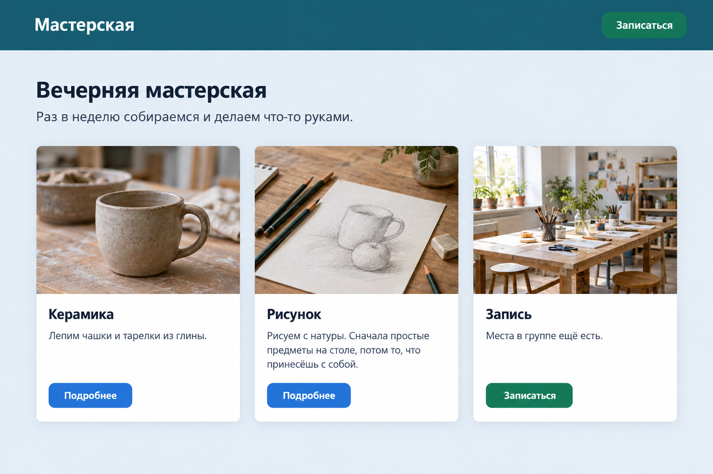
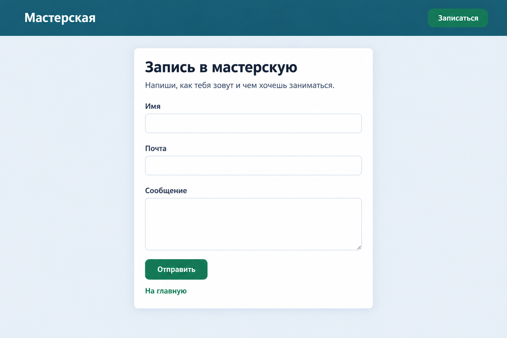

# Занятие 4. Карточки и форма

На сайте кружка обычно две страницы. На первой — карточки с фото. На второй — форма записи. Сегодня собираем обе.

## 1. Теория

### Карточка с фото

Фото бывают разного размера. Картинке задают одну ширину и одну высоту, лишнее обрезают:

```css
.card img {
  display: block;
  width: 100%;
  height: 180px;
  object-fit: cover;
}
```

`object-fit: cover` заполняет прямоугольник и срезает края. Без него браузер сплющивает снимок, чтобы вписать его в эти размеры.

Карточка — это фото и текст под ним. Фото стоит вплотную к краям. Отступ только у текста, иначе снимок не доходит до углов.

```html
<div class="card">
  
  <div class="card-text">
    <h2>Керамика</h2>
    <p>Лепим чашки и тарелки.</p>
    <a class="button" href="signup.html">Записаться</a>
  </div>
</div>
```

```css
.card {
  display: flex;
  flex-direction: column;
  background-color: #ffffff;
  border-radius: 16px;
  overflow: hidden;
  box-shadow: 0 8px 24px rgba(0, 0, 0, 0.12);
}

.card-text {
  display: flex;
  flex-direction: column;
  flex: 1;
  padding: 16px;
}

.card-text .button {
  align-self: flex-start;
  margin-top: auto;
}
```

`box-shadow` рисует тень. Здесь она без сдвига вбок, на 8px вниз, с размытием 24px. Цвет чёрный и почти прозрачный: последнее число в `rgba` — это прозрачность от 0 до 1.

`overflow: hidden` обрезает всё, что вылезает за скруглённые углы. Так углы фото становятся такими же круглыми, как у карточки.

`margin-top: auto` у кнопки забирает свободное место над ней и опускает кнопку вниз. Это видно, когда карточки стоят в одном flex-ряду и тянутся на одну высоту: у короткого текста появляется пустота, и кнопка не остаётся висеть посередине.

Во flex-столбце кнопка сама растягивается на всю ширину карточки. `align-self: flex-start` оставляет её по ширине текста.

Ряд карточек собирают как на третьем занятии: `display: flex` и `gap` у обёртки, `flex: 1` у каждой карточки.

### Один CSS на несколько страниц

В папке лежат `index.html`, `signup.html` и один `style.css`. К каждой странице его подключают одной и той же строкой в `head`:

```html
<link rel="stylesheet" href="style.css">
```

Файл стилей при этом один, не копия на каждую страницу. Правило из него действует везде, где стоит эта строка. Поменял цвет фона в `style.css` — он изменился и на главной, и на странице записи. Если на второй странице строку `link` забыли, она откроется без оформления.

### Ссылка на свою страницу

Ссылка на файл в той же папке — это его имя, без `https://`:

```html
<a href="signup.html">Записаться</a>
<a href="index.html">На главную</a>
```

У названия в шапке, у кнопки и у ссылки «На главную» разные классы. Одно правило на все теги `a` перекрасит сразу и шапку, и ссылку под формой.

Отступ под шапкой задают у блока с заголовком и карточками, не у `body`. Иначе шапка отойдёт от краёв окна.

### Форма

Форма — поля, которые человек заполняет. Подпись и поле связывают так: поле ставят внутрь `label`.

```html
<form>
  <label>
    Имя
    <input type="text" name="name">
  </label>
  <label>
    Почта
    <input type="email" name="email">
  </label>
  <label>
    Сообщение
    <textarea name="message"></textarea>
  </label>
  <button class="button" type="submit">Отправить</button>
</form>
```

| Тег | Что даёт |
| --- | --- |
| `input type="text"` | Одна строка |
| `input type="email"` | Строка для почты. Если текст не похож на адрес, браузер не даст отправить форму |
| `textarea` | Поле в несколько строк |
| `button type="submit"` | Кнопка отправки. Это не ссылка |

`name` — имя поля. Его пишут у каждого `input` и у `textarea`.

Поля ставят столбцом. Кнопку оставляют по ширине текста: во flex-столбце она иначе растянется на всю карточку.

```css
form {
  display: flex;
  flex-direction: column;
  gap: 16px;
}

input,
textarea {
  display: block;
  width: 100%;
  margin-top: 6px;
  padding: 10px 12px;
  border: 1px solid #9aa5b1;
  border-radius: 8px;
  font: inherit;
  box-sizing: border-box;
}

form .button {
  align-self: flex-start;
  border: none;
  font: inherit;
}
```

`font: inherit` берёт шрифт страницы. Без него у поля и кнопки шрифт браузера, не тот, что у заголовка.

`box-sizing: border-box` считает ширину вместе с внутренним отступом и рамкой. Без него поле шире карточки и вылезает за край.

`border: none` убирает серую рамку, которую браузер сам рисует у `button`. Цвет, отступ и скругление у кнопки делают как на втором занятии.

Карточка с формой стоит по центру и уже окна. Фото в ней нет, поэтому отступ задают самой карточке, со всех сторон.

```css
.signup {
  max-width: 480px;
  margin: 40px auto;
  padding: 28px;
  background-color: #ffffff;
  border-radius: 16px;
  box-shadow: 0 8px 24px rgba(0, 0, 0, 0.12);
}
```

`max-width` и `margin: auto` были на первом занятии: карточка не растягивается на всё окно и встаёт посередине.

После нажатия «Отправить» страница обновляется, введённый текст пропадает. Письмо никуда не уходит. Для этого занятия так и задумано.

### Тень при наведении

`:hover` уже был у кнопки. То же пишут у карточки, чтобы усилить тень, пока курсор на ней:

```css
.card:hover {
  box-shadow: 0 16px 36px rgba(0, 0, 0, 0.22);
}
```

Сдвиг вниз больше, размытие шире, чёрный чуть плотнее. Фон карточки здесь не меняют. Когда курсор уходит, снова действует обычная тень.

### Подсказка и курсор в поле

`placeholder` — серая подсказка внутри пустого поля. Когда человек начинает печатать, она пропадает.

```html
<input type="text" name="name" placeholder="Аня">
```

`:focus` — вид поля в тот момент, когда в нём стоит курсор. Свойство задают и для `input`, и для `textarea`.

```css
input:focus,
textarea:focus {
  border-color: #2563eb;
  outline: 2px solid #2563eb;
}
```

`outline` — дополнительная обводка вокруг поля. Она видна только у того поля, в котором сейчас курсор.

## 2. Задания

Папки создавай как на прошлом занятии: в панели **Project** правой кнопкой по проекту → **New** → **Directory**, внутри два **HTML File** и один **File** `style.css`. Каркас у обеих страниц тот же: `lang="ru"`, кодировка, свой `title`, подключённый `style.css`. У `body` убери внешний отступ.

Кнопки-ссылки делай как на втором занятии: прямоугольник, светлый текст, без подчёркивания, при наведении темнеют и не меняют свой цвет на чужой. Кнопке формы добавь `border: none`.

Фото возьми адресом из интернета или файлом рядом со страницей. В `alt` опиши, что на фото.

### 1. Свой сайт

Папка `my-site`. В ней `index.html`, `signup.html` и `style.css`.

Сверстай две страницы так же по блокам, как на картинках. Тексты, цвета и фото возьми свои. С картинок и из примера в теории ничего не копируй.





Тема своя: кружок, игра, город или хобби. Имя указать можно. Фамилию, телефон, адрес и школу не пиши.

Шапка на обеих страницах одна и та же. Название открывает главную, кнопка справа открывает страницу записи.

На главной в одной карточке текст заметно длиннее, чем в двух других. Две кнопки ведут на разные статьи по твоей теме, третья открывает страницу записи.

На странице записи три поля: имя, почта и сообщение. Подписи напиши сам. Ссылка под формой возвращает на главную.

**Проверь:**

- [ ] В папке `my-site` лежат `index.html`, `signup.html` и один `style.css`
- [ ] Тексты, цвета и фото свои
- [ ] Блоки стоят как на картинках: шапка, три карточки, форма в карточке по центру
- [ ] Название в шапке открывает главную, кнопка справа открывает страницу записи
- [ ] Две кнопки карточек открывают разные статьи, третья открывает страницу записи
- [ ] В форме три поля, ссылка под ней возвращает на главную
- [ ] После отправки страница обновляется. Это нормально
- [ ] Если поменять цвет фона в `style.css`, он меняется на обеих страницах

## 3. Задания со звёздочкой

Дополни свой сайт.

### 2. Тень при наведении ★

Наведи курсор на карточку. Тень этой карточки становится заметно сильнее, цвет карточки не меняется. Убери курсор — тень снова как была. Соседние карточки в этот момент не меняются.

**Проверь:**

- [ ] Сильнее тень только у карточки под курсором
- [ ] Фон карточки тот же

### 3. Подсказка и фокус ★

Пока поле пустое, внутри видна серая подсказка. У трёх полей подсказки разные и по твоей теме. Подсказки из теории не копируй. Как только в поле есть текст, подсказки не видно.

Щёлкни внутрь поля. Рамка этого поля становится другого цвета, её хорошо видно на фоне карточки. У остальных полей рамка обычная.

**Проверь:**

- [ ] В трёх пустых полях три разные подсказки по своей теме
- [ ] Подсказка пропадает, когда в поле начинают печатать
- [ ] Рамка другого цвета только у поля, в котором стоит курсор
