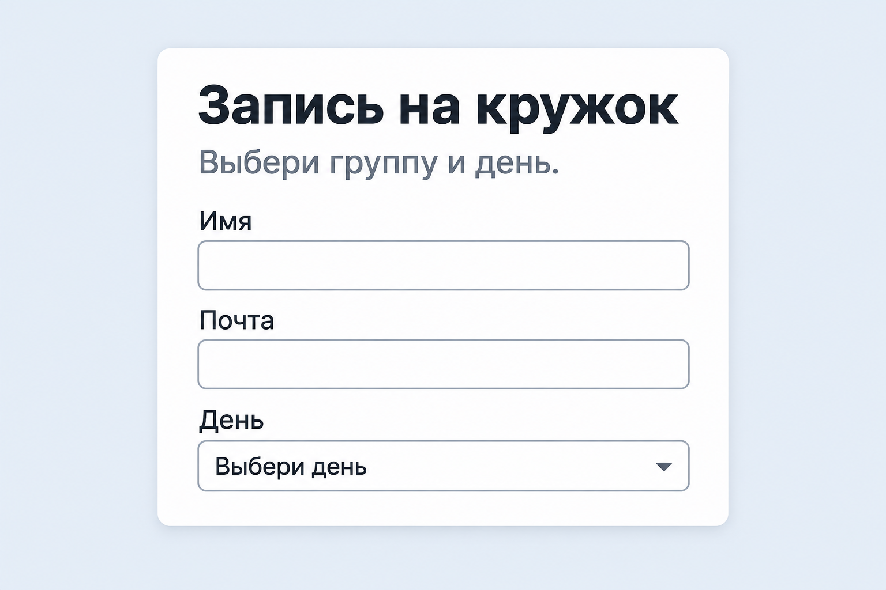
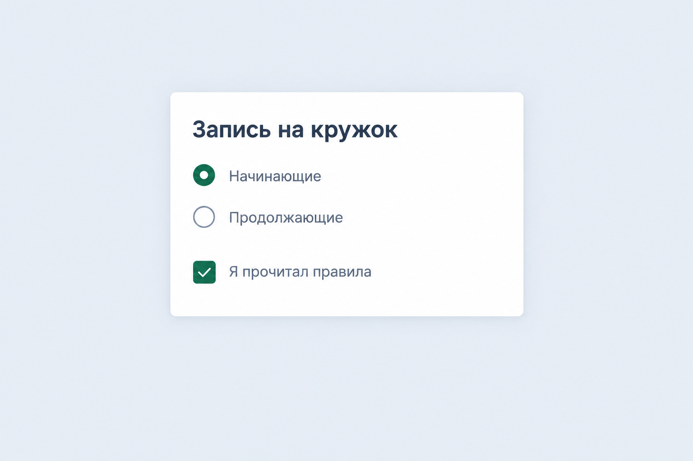
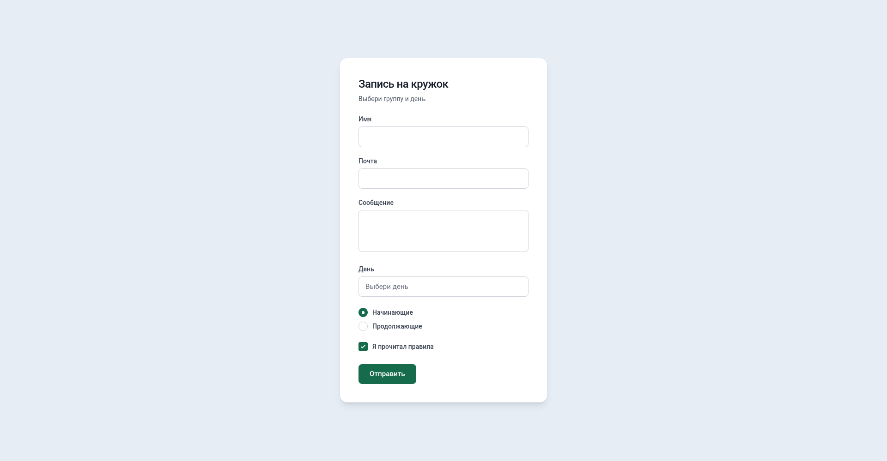

# Занятие 5. Выбор в форме

На четвёртом занятии в форме были строка, почта и большое поле. Сегодня в форму добавляется выбор: список, один вариант из нескольких и галочка.

## 1. Теория

Поле по-прежнему ставят внутрь `label`. Кнопку оформляют как на втором занятии и добавляют `border: none`. После отправки заполненной формы страница обновляется, письмо никуда не уходит.

### Список

`select` — выпадающий список. Каждый пункт — `option`. У списка есть `name`, у пункта — `value`. На странице виден текст пункта, в форму попадает `value`.

```html
<label>
  День
  <select name="day">
    <option value="">Выбери день</option>
    <option value="mon">Понедельник</option>
    <option value="wed">Среда</option>
  </select>
</label>
```

Первый пункт с пустым `value` значит: ещё ничего не выбрано.

### Один вариант из нескольких

`radio` — кружок. Включён может быть только один. У всех кружков одной группы одинаковый `name` и разный `value`.

```html
<label>
  <input type="radio" name="group" value="beginner">
  Начинающие
</label>
<label>
  <input type="radio" name="group" value="continue">
  Продолжающие
</label>
```

Кружок ставят перед текстом, внутри того же `label`.

### Галочка

`checkbox` можно поставить и снять. У неё своё `name`, к группе `radio` она не относится.

```html
<label>
  <input type="checkbox" name="rules">
  Я прочитал правила
</label>
```

Галочку тоже ставят перед текстом, внутри `label`.

### Обязательное поле

`required` пишут у поля, которое нельзя оставить пустым.

```html
<input type="text" name="name" required>
```

У списка `required` ставят на `select`. Пока выбран пункт с пустым `value`, список считается пустым.

У группы `radio` атрибут `required` достаточно написать у одного кружка. Браузер попросит выбрать любой из этой группы.

У галочки `required` значит: её нужно поставить.

Если обязательное поле пустое, браузер не обновляет страницу и подсвечивает поле. Своё сообщение браузера стилями этого занятия не меняют.

### Оформление

Список выглядит как текстовое поле: на всю ширину карточки, со своим внутренним отступом, рамкой, скруглением и фоном.

```css
input[type="text"],
input[type="email"],
select,
textarea {
  display: block;
  width: 100%;
  margin-top: 6px;
  padding: 10px 12px;
  border: 1px solid #9aa5b1;
  border-radius: 8px;
  background-color: #ffffff;
  color: #1f2933;
  font: inherit;
  box-sizing: border-box;
}

select {
  cursor: pointer;
}
```

В правило ширины входят строка, почта, список и большое поле. `radio` и `checkbox` туда не пишут: иначе кружок и галочка растянутся на всю карточку.

Когда список выбран и в нём стоит курсор, рамка меняет цвет. Это тот же `:focus`, что у полей на четвёртом занятии.

```css
select:focus {
  border-color: #2563eb;
  outline: 2px solid #2563eb;
}
```

Кружок и галочку со словами собирают в одну строку. Класс вешают на `label`.

```html
<label class="choice">
  <input type="radio" name="group" value="beginner">
  Начинающие
</label>
```

```css
.choice {
  display: flex;
  align-items: center;
  gap: 8px;
  cursor: pointer;
}

.choice input {
  width: 18px;
  height: 18px;
  margin: 0;
  accent-color: #0f6b4c;
}
```

`gap` — промежуток между кружком и текстом. `align-items: center` ставит их на одну линию по высоте.

`width` и `height` здесь — размер самого кружка или квадрата галочки, не ширина строки. `margin: 0` убирает лишний отступ, который браузер добавляет у этих полей сам.

`accent-color` красит выбранный кружок и поставленную галочку. Пока кружок пустой, он остаётся светлым. Цвет подставь свой.

## 2. Задания

Папку создай как на прошлом занятии: в панели **Project** правой кнопкой по проекту → **New** → **Directory**, внутри **HTML File** `index` и **File** `style.css`. Каркас тот же: `lang="ru"`, кодировка, свой `title`, подключённый `style.css`. У `body` убери внешний отступ.

### 1. Анкета

Папка `anketa`. В ней `index.html` и `style.css`.

Сделай одну страницу: форма внутри карточки по центру, карточка уже окна. Тема своя: кружок, игра, город или хобби. Тексты и цвета свои. Пример из теории не копируй. Имя указать можно. Фамилию, телефон, адрес и школу не пиши.

На странице свой заголовок и одно предложение. Под ними форма:

- строка для имени;
- строка для почты;
- список минимум из трёх своих пунктов и первого пустого пункта «ещё ничего не выбрано»;
- два или больше кружка, выбран может быть только один;
- одна галочка со своей подписью;
- кнопка отправки по ширине текста.

Имя, почта, список, группа кружков и галочка обязательные.

Оставь имя пустым и нажми кнопку: страница не обновляется, поле подсвечено. Заполни всё обязательное и отправь снова: страница обновляется, текст в полях пропадает.

**Проверь:**

- [ ] В папке `anketa` лежат `index.html` и `style.css`
- [ ] Форма в карточке по центру, тексты свои
- [ ] Есть список, кружки и одна галочка
- [ ] Из кружков включается только один
- [ ] Пустое обязательное поле не даёт отправить форму
- [ ] Заполненная форма обновляет страницу

### 2. Список как поле

Дополни анкету. Список оформи так же, как поля на картинке: одна рамка, одно скругление и один шрифт с полями имени и почты. Тексты с картинки не копируй.



Щёлкни по списку. Рамка становится другого цвета. Убери курсор из списка — рамка снова как у обычного поля.

**Проверь:**

- [ ] Список не отличается по рамке, скруглению и шрифту от поля имени
- [ ] Список не шире карточки
- [ ] Рамка другого цвета только пока курсор в списке

### 3. Цвет кружка и галочки

Дополни ту же анкету. Кружки и галочку оформи как на картинке. Цвет и подписи возьми свои.



Нажатие на слова рядом включает кружок или галочку.

**Проверь:**

- [ ] Выбранный кружок и галочка одного своего цвета, пустой кружок светлый
- [ ] Значок крупнее стандартного и не на всю ширину строки
- [ ] Между значком и текстом есть промежуток, они на одной линии
- [ ] Клик по подписи переключает кружок и галочку

### 4. Форма целиком

Собери на этой же странице одну форму, как на картинке. Тексты и цвета свои, с картинки не копируй.



В списке кроме пустого первого пункта минимум три своих. Имя, почта, сообщение, список, кружки и галочка обязательные. Пока курсор в списке, его рамка другого цвета.

Пустое обязательное поле не даёт отправить форму. Заполненная форма обновляет страницу.

**Проверь:**

- [ ] В форме есть строка, почта, большое поле, список, кружки, галочка и кнопка
- [ ] Поля и кнопка выглядят как на картинке
- [ ] Все эти поля обязательные
- [ ] Пустая форма не отправляется, заполненная обновляет страницу
